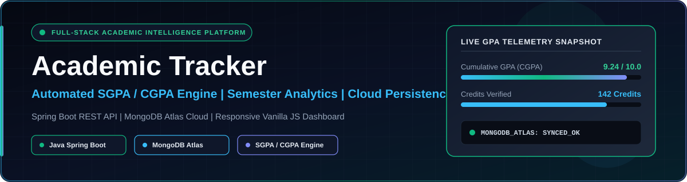
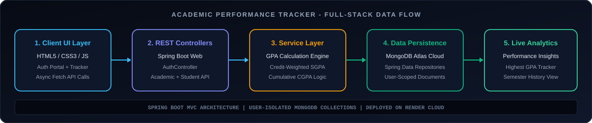
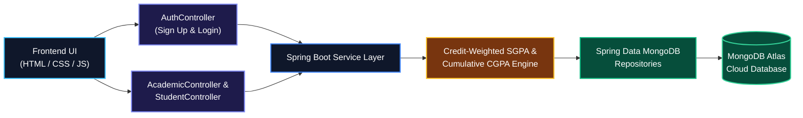

# 🎓 Academic Performance Tracker

<div align="center">

  

  <br/><br/>

  <a href="https://student-marks-manager-1.onrender.com" target="_blank">
    
  </a>

  <br/><br/>

  
  
  
  
  

</div>

---

## 🌐 Live Interactive Deployment

Explore the Academic Performance Tracker through its live full-stack web deployment on Render.

**[🚀 Launch Academic Performance Tracker](https://student-marks-manager-1.onrender.com)**

> **Note:** Hosted on a Render Free Tier instance. If the application takes 30–40 seconds to load on initial access, please allow a moment for the container to spin up from hibernation. Once active, all API operations run smoothly.

---

## 📌 Overview

**Academic Performance Tracker** (`Student-Marks-Manager`) is a full-stack academic record and GPA management platform built using **Java Spring Boot**, **MongoDB Atlas**, and **HTML5/CSS3/JavaScript**.

The platform enables students to create isolated personal accounts, organize semester-wise subjects with marks and credit weights, automatically compute SGPA and cumulative CGPA metrics, and monitor academic progression across their degree.

### 🎯 Core Objectives

- Provide secure student account registration and authentication.
- Organize academic records cleanly across multiple semesters and subjects.
- Automate credit-weighted **SGPA** and cumulative **CGPA** calculations.
- Persist user-isolated academic documents in **MongoDB Atlas**.
- Surface key performance indicators including highest GPA achieved, current semester SGPA, and total credits completed.

---

## 🏗️ System Architecture & Data Flow

<div align="center">

  

</div>

### Request & Persistence Workflow



---

## 🚀 Key Features

### 1. 🔐 Authentication & User Isolation
- Student registration (Sign Up) and login workflows (`auth.html`).
- Individual student profiles with strict user-wise academic data separation.

### 2. 📚 Semester & Subject Management
- Dynamic semester selection and management across the full degree lifecycle.
- Unlimited subject entries per semester capturing **Subject Name**, **Marks Obtained**, and **Credit Value**.

### 3. 📊 Automated GPA & Credit Analytics
- Instant credit-weighted **Semester Grade Point Average (SGPA)** calculation.
- Real-time **Cumulative Grade Point Average (CGPA)** aggregation across all recorded semesters.
- Automated tracking of **Highest GPA Achieved**, **Current Semester SGPA**, and **Total Credits Completed**.

### 4. 📈 Interactive Performance Dashboard
- Unified dashboard (`tracker.html`) displaying semester-wise academic history.
- Side-by-side comparison of semester performance and GPA progression over time.

### 5. 🗄️ Cloud Database Integration
- Backed by **MongoDB Atlas** using Spring Data Repository pattern architecture for reliable cloud persistence.

---

## 🧰 Technology Stack

| Layer | Technology | Purpose |
|---|---|---|
| **Frontend** | HTML5, CSS3, Vanilla JavaScript | Responsive UI, authentication views, and dynamic DOM dashboard |
| **Backend Framework** | Java, Spring Boot | RESTful API controllers, business logic, and GPA computation |
| **Build Tool** | Apache Maven (`pom.xml`) | Dependency management and application packaging |
| **Database** | MongoDB Atlas | Cloud NoSQL document storage for users, semesters, and subjects |
| **Deployment** | Render Cloud | Live web hosting and backend service runtime |

---

## 📂 Repository Structure

```text
Student-Marks-Manager/
├── assets/
│   ├── academic-banner.svg       # Hero banner SVG
│   └── academic-pipeline.svg     # System architecture pipeline SVG
├── frontend/
│   ├── auth.html                 # Sign Up & Login interface
│   ├── index.html                # Landing entry view
│   ├── tracker.html              # Main academic dashboard UI
│   ├── style.css                 # Application styling
│   ├── script.js                 # Authentication & client logic
│   └── tracker-script.js         # Dashboard & API integration logic
├── backend/
│   ├── controller/
│   │   ├── AuthController.java
│   │   ├── AcademicController.java
│   │   └── StudentController.java
│   ├── model/
│   │   ├── User.java
│   │   ├── Semester.java
│   │   ├── Subject.java
│   │   └── Student.java
│   ├── repository/               # Spring Data MongoDB repositories
│   ├── service/                  # SGPA/CGPA business logic services
│   ├── resources/                # Application properties & configs
│   └── pom.xml                   # Maven dependencies
└── README.md
```

---

## 👨‍💻 How It Works

1. **Create an Account:** Register a new student account via the Sign Up portal.
2. **Authenticate:** Log in using your registered credentials to load your personal workspace.
3. **Select Semester:** Choose the target semester you want to record or update.
4. **Add Subjects:** Input each subject's **Name**, **Marks Obtained**, and **Credit Value**.
5. **View Automated Metrics:** The Spring Boot backend computes and updates your **Semester SGPA**, **Overall CGPA**, **Highest GPA**, and **Total Credits Completed** in MongoDB Atlas.
6. **Track Progression:** Review your complete semester-wise academic history directly from the dashboard.

---

## 💻 Local Setup & Execution

### Prerequisites

- Java Development Kit (JDK 17 or higher)
- Apache Maven
- MongoDB Atlas connection URI (or local MongoDB instance)

### 1. Clone the Repository

```bash
git clone [https://github.com/Aditya70-creator/Student-Marks-Manager.git](https://github.com/Aditya70-creator/Student-Marks-Manager.git)
cd Student-Marks-Manager
```

### 2. Configure Database Connection

Update `backend/resources/application.properties` with your MongoDB URI:

```properties
spring.data.mongodb.uri=mongodb+srv://<username>:<password>@<cluster-url>/academic_tracker
spring.data.mongodb.database=academic_tracker
```

### 3. Run the Spring Boot Backend

```bash
cd backend
mvn spring-boot:run
```

### 4. Launch the Frontend

Open `frontend/index.html` in your browser (or serve via VS Code Live Server) to interact with the local backend API.

---

## 🎯 Engineering Outcomes

- Designed a layered **Controller → Service → Repository** backend architecture in Java Spring Boot.
- Modeled hierarchical academic entities (`User`, `Student`, `Semester`, `Subject`) in MongoDB.
- Implemented credit-weighted SGPA/CGPA algorithms with persistent cloud storage.
- Built clean frontend-to-backend REST API communication using asynchronous JavaScript.

---

## 👨‍💻 Author

**Aditya Mitra**

- **GitHub:** [@Aditya70-creator](https://github.com/Aditya70-creator)
- **Repository:** [Student-Marks-Manager](https://github.com/Aditya70-creator/Student-Marks-Manager)
- **Live Application:** [Academic Performance Tracker on Render](https://student-marks-manager-1.onrender.com)

---

<div align="center">

  **Academic Performance Tracker**

  *Streamlining semester tracking and GPA analytics with Spring Boot & MongoDB.*

</div>
